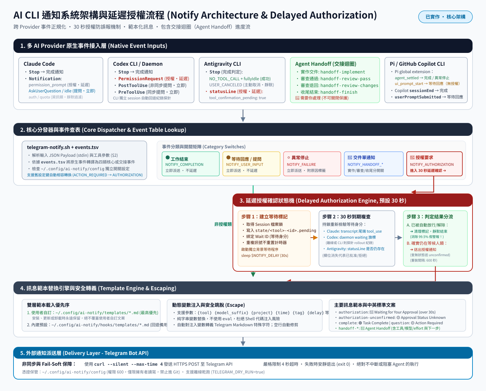

# Notify Hooks — Architecture

This document describes the architecture of the AI CLI notification hook system.

---

## Overview

The notification system allows Claude Code, Codex, Antigravity CLI, Pi, and
Copilot CLI to send Telegram notifications when an agent turn finishes,
requires user attention, or stops abnormally. Pi uses a managed global
extension rather than a native hook registration; its interactive main sessions
can report completion, failure, and UI prompts, but not authorization.

**Design principle:** The repository contains only scripts. All machine state (config files, deployed hooks, settings.json entries) is created exclusively by running the install/update entrypoints — never at repository checkout time.

---

## Architecture Diagram


*圖 1：AI CLI 通知系統整體架構與 30 秒延遲授權狀態機（可點擊連結開啟 SVG 原稿）。*

---

## Directory Structure

```
scripts/
  notify/
    lib/
      config.sh        # Shared: read/write ~/.config/ai-notify/config
      registry.sh      # Shared: register/unregister hooks in AI CLI settings
      settings.sh      # Grouped, draft-only category editor
      runtime.sh       # Explicit helper/venv deployment and support status
      template.sh      # Placeholder rendering, event table lookup, user overrides
      authorization.sh # Delayed authorization wait markers, checks, state pruning
    codex/
      wait.py          # Hook-triggered daemon metadata checker
      requirements.txt # Optional isolated dependency
    pi/
      ai-notify.ts     # Managed Pi extension source
    telegram/
      hook.sh          # Notification hook (called by AI CLI at runtime)
      events.tsv       # Event table: key, category, template, reason label
      templates/       # Built-in message templates (*.md)
      install.sh       # Interactive install wizard
      update.sh        # Update individual config keys
      uninstall.sh     # Remove hooks and config
    line/
      .placeholder     # Reserved for future Line Notify implementation
    README.md          # Provider extension guide

template/common/.claude/
  commands/
    notify-setup.md    # /notify-setup Claude Code command template (installed to .claude/)
```

**Runtime layout (created by install.sh):**

```
~/.config/ai-notify/
  config               # Shell-sourceable key=value (chmod 600)
  hooks/
    telegram-notify.sh # Deployed copy of scripts/notify/telegram/hook.sh
    codex-wait.py      # On-demand checker
    events.tsv         # Deployed event table
    templates/         # Built-in templates, replaced on every update
  templates/           # Optional user overrides <name>.md (never touched by scripts)
  lib/config.sh        # Shared category logic for deployed hooks
  lib/template.sh      # Template rendering
  lib/authorization.sh # Delayed authorization logic
  runtime/codex-wait/ # Optional Python venv, only for enabled new categories
  state/codex-*       # Scoped lock, sanitized trigger mailbox and diagnostics
  state/claude-<session>.pending[.lock/]       # Delayed authorization wait marker + owner PID
  state/antigravity-<session>.pending[.lock/]

# Copilot CLI hooks (opt-in, created by install.sh if user accepts):
.github/
  hooks/
    hooks.json         # Copilot CLI hook config (version:1)

# Native user-level host configuration:
~/.codex/hooks.json                         # Codex Stop + PermissionRequest + question Pre/PostToolUse
~/.gemini/config/hooks.json                 # Antigravity named Stop hook
~/.gemini/antigravity-cli/settings.json     # Approval observer when statusLine is free
${PI_CODING_AGENT_DIR:-~/.pi/agent}/extensions/ai-notify.ts  # Pi extension when detected
```

`~/.gemini/settings.json` is cleanup-only: setup, repair, and uninstall remove
notification-owned legacy Gemini commands but never register new ones.

---

## Config Format

`~/.config/ai-notify/config` is a shell-sourceable key=value file:

```bash
TELEGRAM_ENABLED=true
TELEGRAM_BOT_TOKEN="7123456789:ABCdef..."
TELEGRAM_CHAT_ID="987654321"
NOTIFY_LEVEL=all           # default for completion only: all | attention_required
NOTIFY_COMPLETION=true
NOTIFY_AUTHORIZATION=true
NOTIFY_USER_INPUT=true
NOTIFY_FAILURE=true
NOTIFY_HANDOFF_IMPLEMENT=true    # handoff loop progress; attention has no switch
NOTIFY_HANDOFF_REVIEW=true
NOTIFY_HANDOFF_FINISH=true
NOTIFY_AUTHORIZATION_DELAY_SECONDS=30   # optional; 0 = immediate
NOTIFY_AUTHORIZATION_REARM_SECONDS=600  # optional
# LINE_ENABLED=false       # Future extension
```

**Security:** The file is created with `chmod 600` and never committed to the repository.

**Category resolution.** Four categories, one switch each: completion, authorization, user input, failure. Order: environment new key → environment legacy keys → config-file new key → config-file legacy keys → default. Only exact `true`/`false` count. Legacy keys `NOTIFY_ACTION_REQUIRED`, `NOTIFY_CODEX_HUMAN_APPROVAL`, `NOTIFY_CODEX_USER_INPUT` are still read: authorization from ACTION_REQUIRED + CODEX_HUMAN_APPROVAL, user input from ACTION_REQUIRED + CODEX_USER_INPUT; within one source any `true` wins, otherwise any `false`, otherwise undefined. Defaults: completion follows `NOTIFY_LEVEL`; the other three are on.

**NOTIFY_LEVEL values:**
| Value | Behaviour |
|-------|-----------|
| `all` (default) | Completion on by default |
| `attention_required` | Completion off by default |

The legacy `notify_only` value is read as `attention_required`. Saving the category menu writes the four new keys and removes the three legacy keys in one atomic write; changing the level writes only `NOTIFY_LEVEL` and `NOTIFY_COMPLETION`.

---

## Installation Flow

```
User runs: bash scripts/notify/telegram/install.sh
          (or: /notify-setup → setup in Claude Code)

Step 1  Guide user to create Telegram Bot via @BotFather
Step 2  Read and validate Bot Token (Telegram API call)
Step 3  Auto-detect Chat ID (getUpdates API call)
Step 4  Edit grouped category switches and confirm summary
Step 5  Write ~/.config/ai-notify/config (chmod 600)
Step 6  Deploy hook + common config library + checker; provision isolated dependency only if selected
Step 7  Register Claude plus detected Codex and Antigravity hooks; attempt approval observation safely; install the Pi extension when Pi is detected
Step 8  Optionally register Copilot CLI hooks in .github/hooks/hooks.json [y/N]
Step 9  Send test notification to confirm end-to-end
```

**Idempotent:** Running `install.sh` multiple times is safe. Existing config values are preserved unless overwritten, and `registry.sh` prevents duplicate hook entries.

---

## Hook Lifecycle

```
AI CLI event fires (e.g., task complete)
        │
        ▼
Native AI CLI hook, Antigravity status state, or Pi global extension
        │
        ▼
bash ~/.config/ai-notify/hooks/telegram-notify.sh <event-type> [tool-name]
  (stdin: JSON payload from AI CLI)
        │
        ├─ source ~/.config/ai-notify/config
        ├─ TOOL_NAME = $2 arg (set by registry.sh) or "AI CLI"
        ├─ PROJECT_DIR from payload cwd/workspace, CLAUDE_PROJECT_DIR, or PWD
        ├─ SESSION_LABEL from session/conversation payload or Copilot env
        ├─ update Antigravity approval state and parse terminal reason
        ├─ for Codex permission/sync-question hooks: independently start opt-in inspection
        ├─ for Codex async-question results: validate accepted=true without daemon inspection
        ├─ classify via events.tsv: completion / authorization / user_input / failure,
        │  or handoff_implement / handoff_review / handoff_finish / attention for `handoff` events
        ├─ apply the category switch (NOTIFY_LEVEL only defaults completion)
        ├─ authorization: record a wait and let a detached check decide after the delay
        ├─ check TELEGRAM_ENABLED and credentials (skipped in dry-run)
        ├─ return the provider-neutral control response
        ├─ render template (user override → built-in); escape values for Markdown
        └─ curl --silent --max-time 4 Telegram API || true
           (always exits 0; curl is bounded to four seconds)
```

---

## Data Formats

AI CLI 工具透過 `stdin` 將 JSON payload 傳遞給 Hook 腳本。

### Standard JSON Payload (Incoming)

```json
{
  "hook_event_name": "Stop",     // 事件類型：Stop | Notification | sessionEnd | ...
  "message": "...",              // (選填) 通知詳細訊息，如等待授權的內容
  "cwd": "/path/to/proj"         // (選填) 專案路徑
}
```

*   **Claude Code**: 傳送 `Stop` 與 `Notification` 事件；`permission_prompt` → 授權（延遲；但等待中的工具為 `AskUserQuestion` 時改為事件鍵 `notification:question`，等待回應、立即），`idle_prompt`、`agent_needs_input`、`elicitation_dialog`、`elicitation_url_dialog` 與無類型 → 等待回應（立即），其他類型不送。
*   **Codex**: 傳送 `Stop` 與 `PermissionRequest`；notification hook 回傳
    neutral `{}`，不代替使用者決定。
*   **Antigravity CLI**: `Stop` 提供 `fullyIdle` 與
    `terminationReason`（見下方 Antigravity 一節）；managed status line 提供
    `tool_confirmation_pending`。
*   **Pi**: global extension sends `pi-stop` after `agent_settled` and
    `pi-question` for an in-run `ui_prompt_start`; it includes only the session
    ID, working directory, computed stop reason, and active model ID. It does
    not forward prompts or raw errors. Only TUI main sessions notify.
*   **Copilot CLI**: 傳送 `sessionEnd` 與 `userPromptSubmitted` 事件。

---

## Shared Libraries

### `scripts/notify/lib/config.sh`

| Function | Description |
|----------|-------------|
| `normalize_notify_level VALUE` | Return `all` or `attention_required`, including the legacy alias |
| `read_config` | Source the config file into current shell |
| `write_config KEY=VAL ...` | Create/overwrite config with given pairs (chmod 600) |
| `update_config_key KEY VAL` | Atomically update one key; preserve other lines |
| `update_config_keys KEY VAL ...` | Atomically apply a whole draft, preserving other keys |
| `notify_category_value KEY` | Resolve a category through the new/legacy key order and default |
| `remove_config_keys_by_prefix PREFIX` | Remove all keys matching a prefix |

### `scripts/notify/lib/registry.sh`

| Function | Description |
|----------|-------------|
| `register_hook <hook_path>` | Register Claude plus detected Codex and Antigravity hooks, install the owned Pi extension when Pi is detected, and clean owned legacy Gemini entries |
| `unregister_hook <hook_path>` | Remove owned global hook entries and the owned Pi extension without affecting other hooks |
| `register_hook_copilot <hook_path>` | Write `sessionEnd` + `userPromptSubmitted` entries to `.github/hooks/hooks.json` (idempotent) |
| `unregister_hook_copilot <hook_path>` | Remove Copilot hook entries from `.github/hooks/hooks.json` |
| `register_hook_codex <hook_path>` | Add neutral `Stop`, `PermissionRequest`, question `PreToolUse` / `PostToolUse` hooks |
| `register_hook_antigravity <hook_path>` | Add the named global Antigravity `Stop` hook |
| `register_hook_antigravity_statusline <hook_path>` | Add approval-state observation without overwriting another command |
| `show_hook_status <hook_path>` | Report provider registration, including Pi extension ownership/conflicts, without reading credentials |

All functions require `jq`.

---

## Provider Hook 實作規則與真實踩坑盤點 (Real-World Provider Hook Rules & Pitfalls)

在 `refine-notify-core`、`add-handoff-notifications` 與 `WI-20261118-notify-optimization` 的實作與真實重播驗收中，各 AI Provider 表現出許多未在官方文檔充分說明的邊界行為。本節詳細記錄這些關鍵規則，避免後續重複踩坑。

### 1. Claude Code 實作規則與特例

- **`permission_prompt` 複合型態陷阱 (實測重大特例)**：
  - Claude Code 的 `AskUserQuestion`（向使用者提出結構化問題）在送出通知時，其 `notification_type` 竟然標註為 `permission_prompt`，而不是問句專屬型態。
  - **因應實作**：Hook 不能只依賴 `notification_type`。當收到 `permission_prompt` 時，必須向後解析 `transcript_path` 尾端未取得結果的 `tool_use`；若工具名稱為 `AskUserQuestion`，必須轉譯為事件鍵 `notification:question`，分類至「等待回應（User Input）」，**立即發出通知，絕不可進入 30 秒延遲確認**。
- **原生 6 秒詢問前緩衝**：
  - Claude Code 在終端機提出提問或等待核准時，其內部原生會在等候約 6 秒後才真正觸發 `Notification` hook。此延遲為 Claude 核心機制，外部 hook 無法縮短。
- **純資訊型通知靜默過濾**：
  - 登入成功（`auth_*`）、額度自動恢復（`quota_auto_resume_*`）等通知屬於資訊類，在 `events.tsv` 中歸類為 `none`，完全不發送 Telegram 通知，避免干擾使用者。
- **等待身分（Wait Identity）定位**：
  - 提取 `transcript_path` 尾端未取得 `tool_result` 的 `tool_use.id` 作為該次等待的唯一識別碼；一旦出現相同 ID 的 `tool_result` 即視為解除證據；收到 `Stop` hook 也會自動清除。

### 2. Codex CLI 與 Daemon 實作規則與特例

- **CLI Session 未載入 Daemon 之關鍵事實 (實測重大發現)**：
  - 本機以 CLI 啟動的 Codex session，**預設根本沒有載入在 daemon 中**！daemon 雖能連線，但對該 session 呼叫 `thread/read` 時從頭到尾回報 `notLoaded`。
  - 實測在終端機人工等待核准 40 秒的過程中，daemon 也從未回報 `waitingOnApproval` 旗標。
  - 統計本機歷史 session，高達 38% 的情境完全無法連線 daemon。
- **Session 紀錄盲點與無法確認 (Unconfirmed) 回退**：
  - Codex 的 session 紀錄（`rollout-*-<session_id>.jsonl`）在「提出授權請求」與「取得執行結果」之間，**完全沒有任何『已核准、開始執行』的狀態標記**！
  - 因此在無法查詢 daemon 的情境下，只看 session 紀錄根本無法區分「正在等人核准」與「已自動放行但指令執行超過 30 秒」。
  - **決策與範本 (D-004)**：當無法查詢 daemon 且 30 秒到期時，紀錄若仍無結果，發送 **`authorization-unconfirmed` 範本**（英文：「🟡 Approval Status Unknown … may be waiting for approval, but this could not be confirmed」），標明「可能在等待授權，無法確認」，絕不宣稱確定在等。
- **自動審核（Auto-review / Approve for me）假警報過濾**：
  - 當設定 `approvals_reviewer = "auto_review"` 時，越界請求（如 `git push`、`gh`）幾乎都在 5～10 秒內被自動審核放行（統計 156 個 session、226 次請求，中位數 5.9 秒，只有 1 次超過 30 秒）。
  - 若在 `PermissionRequest` hook 觸發瞬間直接發通知，會產生 99.5% 的虛假警報。**30 秒延遲確認機制成功消除了所有自動審核的誤報**。
- **非同步提問無等待旗標**：
  - `request_user_input_async` 透過 message 送出，不會拉起 daemon 的 `waitingOnUserInput` 旗標。Hook 在 `PostToolUse` 驗證其結果為 `accepted=true` 時立即發出等待回應通知。
- **過期狀態檔自動清理**：
  - 每次啟動 Codex 檢查器時，自動掃除 `~/.config/ai-notify/state/` 內符合命名規則、超過 7 天且鎖已釋放的過期狀態檔，防止長時間累積。
- **三態啟用要求**：
  - `~/.codex/hooks.json` 寫入成功僅代表 `configured`；使用者必須在 Codex 終端機開啟 `/hooks`，確認為 `Trust: Trusted`，並將 `[ ] Hook 1` 勾選手動啟用為 `[x] Hook 1`。

### 3. Antigravity CLI 實作規則與特例

- **原生 Hook 缺乏授權與提問事件**：
  - Antigravity 只有 `SessionStart`、`PreToolUse`、`PostToolUse`、`PreInvocation`、`PostInvocation`、`Stop` 六個原生 Hook。
  - 缺乏原生授權/提問 hook，授權確認必須掛在 `~/.gemini/antigravity-cli/settings.json` 的 `statusLine`，監聽 `tool_confirmation_pending: true`。
- **狀態列回報的真實行為 (實測重大特例)**：
  - 當需要確認時，狀態列會帶 `tool_confirmation_pending: true`（`agent_state: tool_use`），但它只在觸發當下回報 2～3 次，**等待期間不會持續回報**。
  - 當使用者核准或拒絕後，約 0.2～2 秒內狀態列會再次刷新，此時 `tool_confirmation_pending` 欄位**直接消失（完全省略），從未出現 `false`**。
  - 使用者按 `Esc` 取消或拒絕確認時，**完全不會觸發 `Stop` hook**！唯一的解除證據就是狀態列再次更新時該欄位消失。
- **無請求識別碼的合併與重新武裝政策**：
  - 狀態列無法提供個別指令的 tool call id。同 session 在等待期間重複收到的訊號一律視為同一段等待（不重新計時、不重複發送）。
  - 標記在解除證據到達時清除；若已發出通知，必須間隔 `NOTIFY_AUTHORIZATION_REARM_SECONDS`（預設 600 秒）以上到達的新訊號才會視為新一段等待重新武裝。
- **完成狀態碼演進**：
  - `agy` 1.5.10+ 的正常完成已改為 `NO_TOOL_CALL`（舊版為 `model_stop`），且須滿足 `fullyIdle: true`（代表背景指令與子代理全部結束）。
  - `USER_CANCELED` 視為使用者主動中斷，靜默不通知；其餘終止原因標記為 Task Stopped，並附帶乾淨的原因標籤。

### 4. Agent Handoff (交接迴圈) 專屬規則

- **專屬事件與獨立開關**：
  - 實作完成（`handoff-implement`，開關 `NOTIFY_HANDOFF_IMPLEMENT`）
  - 審查結果（`handoff-review`，依 verdict 呈現審查通過或退回修正，開關 `NOTIFY_HANDOFF_REVIEW`）
  - 收尾完成（`handoff-finish`，開關 `NOTIFY_HANDOFF_FINISH`）
  - 需要你處理（`handoff-attention`，**不可關閉**）
- **停點不可關閉保護 (Safety Anchor)**：
  - 當迴圈遇到 blocked、達輪數上限、工作區不乾淨、或審查通過等待使用者執行 `handoff-finish` 時，`handoff-attention` 永遠強制發送，不受一般開關影響，防止迴圈靜默掛起。
- **Agent 資訊提取**：
  - 透過 `xirp session get <id> --json` 提取停下 Session 的工具（`.currentAgent`）、當下模型（`.model`）與推理強度（`.agentLaunchOptions.options.effort` 或 `reasoning_effort`），組合為 `Agent Handoff (Claude / claude-opus-5-5 / high)`。
- **傳訊失敗重試保障**：
  - 對審查者或實作者傳訊失敗時，交件單不標記為已處理，而是改發一則「需要你處理」提醒，保留交件單待下次 hook 或手動執行重試。

---

## Codex Integration

Codex hooks live in `~/.codex/hooks.json`. The installer adds `Stop` for
completion and `PermissionRequest` for approval notifications. Both invoke the
deployed hook with a five-second native timeout. The hook returns `{}` and never
returns `allow`, `deny`, `block`, or `continue`, so Codex retains its normal
approval and stopping behavior.

Non-managed Codex command hooks have three independent runtime states:

1. configured in `~/.codex/hooks.json`;
2. trusted in `/hooks`;
3. enabled with an `[x]` checkbox in `/hooks`.

All four owned definitions must be trusted and enabled. `Trust:
Trusted` does not override an unchecked `[ ] Hook 1`; that hook remains
disabled. `show_hook_status` reports only whether the owned commands exist in
configuration because Codex does not expose trust and enablement through the
registry file.

The authorization notice contains only a generic tool label. Raw commands,
arguments, prompts, descriptions, and transcript paths are not forwarded.

---

## Codex On-demand Inspection

PermissionRequest never sends at the moment it is raised, even with delay 0; it only starts the checker (when authorization or user input is on). See Delayed Authorization below. PreToolUse retains the `^(request_user_input|request_user_input_async)$` matcher for existing installations; the async tool returns neutrally without starting inspection, while synchronous questions start the checker.

Async questions are emitted as messages and do not raise waitingOnUserInput. A separate PostToolUse handler matches `^request_user_input_async$`, validates the native event/tool name and accepted=true result (JSON object or JSON string), then reuses the user-input category and sanitized renderer. Missing, malformed, rejected and disabled results remain silent. This means a question was posted, not that generation is blocked. No question text or raw tool output is persisted or forwarded, and no daemon is needed for this path.

The hook sends only session_id, turn_id and cwd to `codex-wait.py start`, then returns neutral JSON. An inherited advisory lock coalesces workers by CODEX_HOME/session. A sanitized trigger mailbox hands new-turn hooks to an existing worker without losing them during shutdown. Atomic state holds only turn/PID, wait flags and generic diagnostics. No raw tool input or transcript is retained.

The checker uses websocket-client over a socketpair connected to `codex app-server proxy`; the CLI resolves its own control socket. It never starts a daemon and never calls thread/resume. RPCs are limited to initialize, thread/read with includeTurns=false, and thread/turns/list with itemsView=notLoaded. Waiting flags are sampled at one-second intervals and validated against the triggering turn before notification. No flag means no human-wait message, even during automatic review.

Continuous waiting episodes are independently deduplicated for waitingOnApproval and waitingOnUserInput. Explicit absence re-arms notification; reconnect retains the last notified flags. A worker exits at turn completion/change without a new trigger, thread unload, disabled settings, or bounded transport recovery failure. There is no LaunchAgent. Notification delivery is attempted once per episode; a network timeout does not cause repeated attempts for that wait.

The runtime counts as unable to be queried when the daemon is unreachable or when it reports the triggering session as `notLoaded` on the first query. The latter is normal for a Codex session started from the terminal, which is never loaded in the daemon (live capture, 2026-11-18); `notLoaded` after the session was seen `active` still means the turn finished. In that case the checker keeps the request until the delay passes, then reads the Codex session record (payload `transcript_path`, else `$CODEX_HOME/sessions/*/*/*/rollout-*-<session_id>.jsonl`): a `*_call_output` for the open call or a `task_complete` / `turn_aborted` event means silence; otherwise, or when unreadable, it sends the unconfirmed notice. Each Codex inspection start prunes notification-owned state older than 7 days whose lock is free (`codex-<24 hex>.{lock,json,request.json,model.json}` together, and `claude-*.pending` / `antigravity-*.pending` whose lock directory has no live PID).

Status probes report metadata connectivity separately from live hook/delivery coverage. Confirmed approval and synchronous-input inspection require the existing local daemon; async question-posted notifications use native hooks. General prose questions are not inferred. See [setup and limitations](/docs/notify/telegram.md).

---

## Delayed Authorization

Authorization notices are sent only if the wait is still unresolved after `NOTIFY_AUTHORIZATION_DELAY_SECONDS` (default 30; 0 immediate; non-numeric or negative → 30), at most once per continuous wait.

| Host | Start signal | Wait identity / clearing |
|---|---|---|
| Claude Code | `Notification` with `permission_prompt` | Last `tool_use` in `transcript_path` without a `tool_result`; a matching `tool_result` before the delay means silence; unreadable record sends the unconfirmed notice; `Stop` clears |
| Antigravity | Status line `tool_confirmation_pending` true | None; false or `Stop` clears |
| Codex | `PermissionRequest` starts `codex-wait.py` | `waitingOnApproval` held beyond the delay (daemon), or session-record check (no daemon) |

Waits without an identifier are merged: repeated start signals never restart the delay or send a second notice, and an un-notified wait never ages out. A notified wait re-arms on a start signal at least `NOTIFY_AUTHORIZATION_REARM_SECONDS` after the notice (default 600; invalid → 600; whole-second clock, so a re-arm may come up to one second early); resolution evidence re-arms at once. Every marker change happens under the session lock; clearing fixes its target wait when the resolution arrives, and when the lock is held by a live process a detached retry waits for it and clears the marker only if it still holds that wait. Known limitation: without a resolution signal, a second wait right after the first is merged into it. An approved Codex command still running past the delay also gets the unconfirmed notice (accepted).

Markers `claude-<session>.pending` and `antigravity-<session>.pending` each have a lock directory `<marker>.lock` holding the owner PID. A detached background check per wait acts only if the marker still carries its own wait identity. Notices contain only tool, project, session label, time and a generic tool label.

---

## Message Templates

`telegram/events.tsv` maps an event key to category, template and reason label (`<prefix>:*` is the fallback; category `none` is never sent; absent events keep the generic "AI CLI Event" message). Built-in templates in `telegram/templates/` deploy to `~/.config/ai-notify/hooks/templates/` and are replaced on every update; `~/.config/ai-notify/templates/<name>.md` overrides one by name, and a missing, empty or unreadable file falls back to the built-in. Install, update, fix-hooks and uninstall never touch the override directory; uninstall removes only the built-in templates and the table.

`handoff` events come from the agent handoff loop (`scripts/handoff/handoff-route`) with a JSON body; the `kind` field selects `handoff:<kind>`. Progress kinds follow `NOTIFY_HANDOFF_IMPLEMENT`, `NOTIFY_HANDOFF_REVIEW` and `NOTIFY_HANDOFF_FINISH` (missing = on); `attention` is always sent while Telegram is enabled and falls back to built-in text when its row or template is missing. The hook script carries the line `# ai-notify-capability: handoff-events`, which the handoff side reads to decide between handoff events and the generic notice.

Placeholders: `{title_suffix} {tool} {project} {time} {tag} {message} {reason} {request_tool} {delay}`. Values are escaped for Telegram legacy Markdown; a line made only of empty placeholders is removed; unknown placeholders stay as is. There is no eval, condition or loop.

---

## Antigravity CLI Integration

Antigravity completion hooks live in `~/.gemini/config/hooks.json` under the
owned `telegram-notify` definition. `Stop` emits a result only when
`fullyIdle=true`. `terminationReason` is compared case-insensitively: `NO_TOOL_CALL` and legacy `model_stop` are Task Complete, `USER_CANCELED` is silent, everything else is Task Stopped with a reason label from `events.tsv` (e.g. `ERROR` → "error", `MAX_TOKEN_BUDGET_EXCEEDED` → "token budget exceeded", unknown → "execution stopped"). Raw error text is never included. The hook returns `{"decision":"stop"}`, which permits the documented
stop instead of re-entering the execution loop.

Antigravity approval observation uses
`~/.gemini/antigravity-cli/settings.json`. Setup and `fix-hooks` attempt it
automatically whenever Antigravity is detected:

```json
{
  "statusLine": {
    "type": "command",
    "command": "bash \"/Users/<user>/.config/ai-notify/hooks/telegram-notify.sh\" antigravity-statusline \"Antigravity CLI\""
  }
}
```

The observer starts a delayed authorization wait on `tool_confirmation_pending=true`. With no request identifier, a status line whose `tool_confirmation_pending` is no longer true (Antigravity 1.5.10 omits the field once the confirmation is answered; it never sends false), or the conversation's `Stop`, clears the wait, even when Telegram delivery is disabled. It prints a compact agent-state value so it
remains a valid status-line command. A different existing command is preserved
and reported as `Antigravity approval: unavailable (statusLine conflict)`.

---

## Copilot CLI Integration

Copilot CLI uses a repository-local hook file rather than global host settings.

### Hook file: `.github/hooks/hooks.json`

```json
{
  "version": 1,
  "hooks": {
    "sessionEnd": [
      { "type": "command", "bash": "bash \"/Users/<user>/.config/ai-notify/hooks/telegram-notify.sh\" sessionEnd \"Copilot CLI\"" }
    ],
    "userPromptSubmitted": [
      { "type": "command", "bash": "bash \"/Users/<user>/.config/ai-notify/hooks/telegram-notify.sh\" userPromptSubmitted \"Copilot CLI\"" }
    ]
  }
}
```

### Event mapping

| Copilot CLI event | Mapped to | Message type |
|-------------------|-----------|-------------|
| `sessionEnd` | `stop` (task complete) | 🟢 Task Complete |
| `userPromptSubmitted` | `notification` (action required) | 🟡 Action Required |

### Tool name in hook.sh

`hook.sh` receives the tool name as `$2` CLI argument, hardcoded by `registry.sh` at registration time:

| Caller | `$1` (event) | `$2` (tool name) |
|--------|-------------|-----------------|
| Claude Code | `stop` / `notification` | `"Claude Code"` |
| Codex | `codex-stop` / `codex-permission` | `"Codex"` |
| Antigravity CLI | `antigravity-stop` / `antigravity-statusline` | `"Antigravity CLI"` |
| Pi | `pi-stop` / `pi-question` | `"Pi"` |
| Copilot CLI | `sessionEnd` / `userPromptSubmitted` | `"Copilot CLI"` |

When `$2` is absent (old-format registered hooks), `TOOL_NAME` defaults to `"AI CLI"`. Run `fix-hooks` to upgrade:

```bash
bash scripts/notify/telegram/update.sh fix-hooks
```

---

## Pi Extension Integration

Pi has no hook configuration file. When Pi is detected, the shared registry
installs `scripts/notify/pi/ai-notify.ts` as
`${PI_CODING_AGENT_DIR:-~/.pi/agent}/extensions/ai-notify.ts`. The extension
runs the deployed notification hook in a detached process and swallows all
startup and delivery errors, so notifications never delay or change the Pi
session.

It sends one `pi-stop` event after Pi has settled: normal completion maps to
completion, an error maps to failure, and a user abort is silent. An in-run UI
prompt maps to `pi-question`; an idle prompt is silent. The payload includes
only the session ID, working directory, stop reason, and active model ID.
Interactive TUI main sessions notify; print, JSON, RPC, and subagent sessions
do not. Pi has no authorization-notification integration.

The registry updates or removes only a regular `ai-notify.ts` whose first line
has the ownership marker. A same-name user file or symlink remains untouched
and status reports Pi as unavailable. Open Pi sessions need `/reload` or a
restart after installation or removal. See [Pi Extension Integration](/docs/hooks/pi-hooks.md)
for setup, status values, and troubleshooting.

---

### Setup

Copilot hook registration is **opt-in** during `install.sh` (step 8). The resulting `.github/hooks/hooks.json` can be committed to the repository so all machines with the notify hook installed benefit automatically.

To register after install:
```bash
bash scripts/notify/telegram/update.sh copilot-hooks
```

---

## How to Add a New Provider

See the [provider extension guide](/scripts/notify/README.md) for the step-by-step provider extension workflow.

Summary:
1. Copy `scripts/notify/telegram/` to `scripts/notify/<provider-name>/`
2. Implement `hook.sh` with the standard interface
3. Use `{PROVIDER}_ENABLED` config key prefix
4. Deploy hook to `~/.config/ai-notify/hooks/<provider-name>.sh` from `install.sh`
5. Call `register_hook` / `unregister_hook` from shared library

---

## Rollback

```bash
# Full removal
bash scripts/notify/telegram/uninstall.sh

# Or in Claude Code
/notify-setup → uninstall
```

Uninstall removes owned Claude, Codex, and Antigravity hook entries, the owned
Pi extension, any notification-owned legacy Gemini commands, Antigravity notification state,
`TELEGRAM_*` keys, the deployed hook, built-in templates and the event table (user templates stay). It cooperatively stops owned Codex checkers and removes their isolated runtime/state. It removes repository-local Copilot
entries only after separate confirmation. Unrelated hooks and settings remain
unchanged.

To migrate, rerun `update.sh` (or `fix-hooks`); hook registrations are unchanged, so Codex needs no re-trust and existing configs need no edits. Rollback redeploys the previous hook; legacy keys already removed by a menu save must be set again.

Before rolling back to a hook release that predates `attention_required`, set
the config value back to its legacy spelling, `notify_only`.

# Citations

[1] [OpenAI Codex Hooks](https://developers.openai.com/codex/hooks)
[2] [Google Antigravity Hooks](https://antigravity.google/docs/hooks)
[3] [Google Antigravity Status Line](https://antigravity.google/docs/cli/statusline)

[4] [OpenAI Codex App Server](https://learn.chatgpt.com/docs/app-server)
[5] [websocket-client custom sockets](https://websocket-client.readthedocs.io/en/latest/examples.html#connecting-with-custom-sockets)
