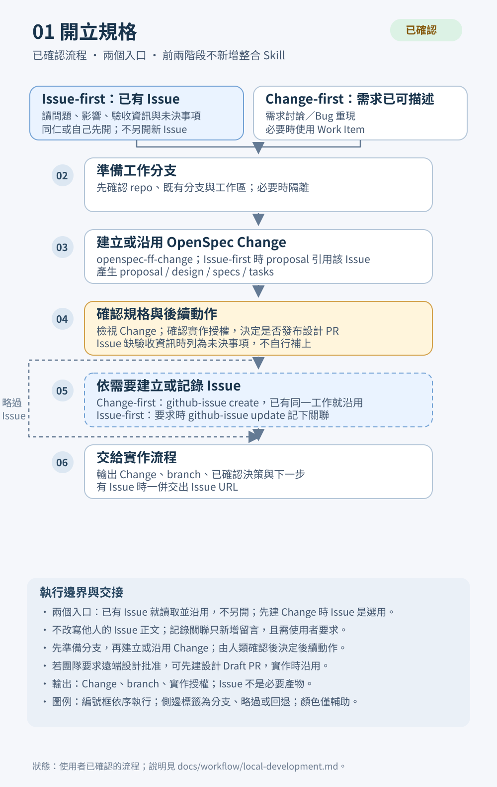
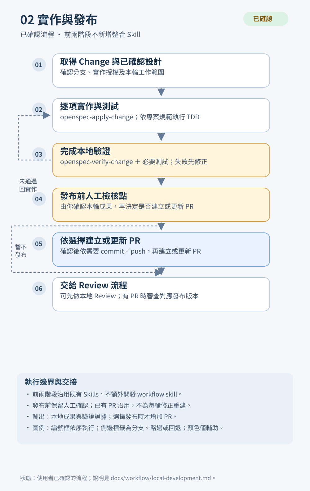
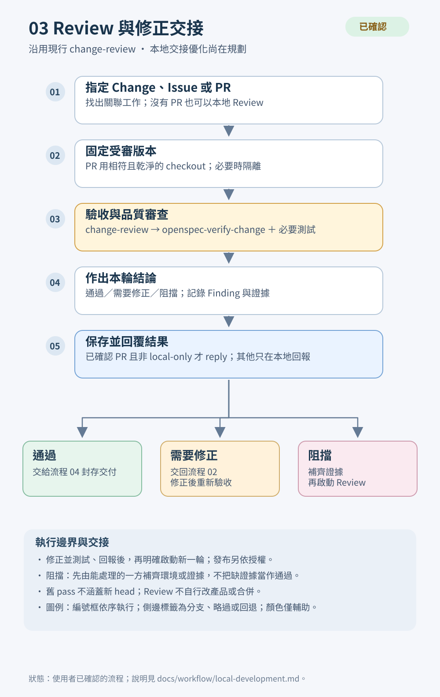
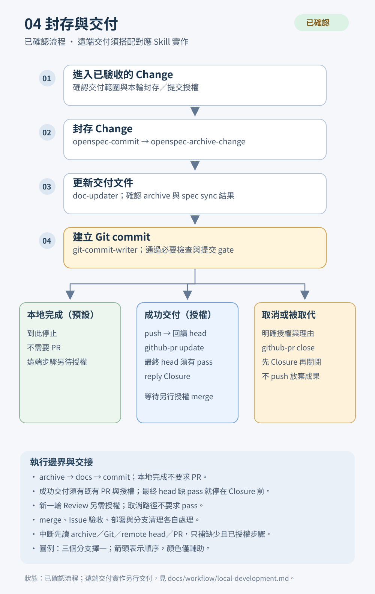

# 本機開發四階段流程

這是本 repo 採用的本機標準開發流程。將日常開發工作收斂為清晰的四個階段：開立規格、實作與發布、Review 與修正交接、封存與交付。
GitHub Issue／PR 的格式、寫入前核對與結案規則在 `github-issue`、`github-pr` Skill 內；各階段在哪些時點接上 GitHub，見 [GitHub 協作整合](../github-handoff.md)。

## 四階段總覽

```text
  ┌─────────────────┐       ┌─────────────────┐
  │  01 開立規格    │ ───►  │  02 實作與發布  │
  │  釐清需求與產出 │       │  TDD、驗證與檢核│
  └─────────────────┘       └────────┬────────┘
                                     │
                                     ▼
  ┌─────────────────┐       ┌─────────────────┐
  │  04 封存與交付  │ ◄───  │  03 Review 審查 │
  │  封存、文件與提交│ (pass)│  結論判定與修正 │
  └─────────────────┘       └─────────────────┘
```

| 階段 | 核心目標 | 呼叫工具 / 指令 | 產出成果 |
| --- | --- | --- | --- |
| **01 開立規格** | 釐清需求，建立分支與規格 | `opsx-branch`, `openspec-ff-change` | 規格 artifacts, `feature/<change-id>` |
| **02 實作與發布** | 依規格 TDD 實作並驗證功能 | `openspec-apply-change`, `openspec-verify-change`, `github-pr create` | 完成之代碼、測試通過證據、Draft PR（選用） |
| **03 Review 與修正交接** | 驗收功能品質，產出結論 | `change-review`, `github-pr reply` | 審查結論（pass / changes-required / blocked） |
| **04 封存與交付** | 封存規格、同步文件、提交並交付 | `openspec-commit` | 封存目錄、同步文件、Conventional Commit、交付 PR（選用） |

每張圖只保留 SVG 原稿。

## 01 開立規格

[SVG 原稿](../diagrams/local-development-define.svg)



開立規格有兩個入口，規劃確認後都交給實作：

| 項目 | Issue-first | Change-first |
| --- | --- | --- |
| 起點 | 同仁或自己已開了 Issue | 需求或 Bug 已能在本機描述；需要多輪討論時，可在本機使用 Work Item |
| 主路徑 | 讀取 Issue 的問題、影響、驗收資訊與未決事項 → 確認 repo、既有分支與工作區 → 準備工作分支 → 建立或沿用對應的 Change（proposal 引用該 Issue） → 人工確認規格與後續動作 | 確認 repo、既有分支與工作區 → 準備工作分支 → `openspec-ff-change` → 人工確認規格與後續動作 |
| GitHub 觸點 | 使用者要求記下關聯時，以 `github-issue update` 在該 Issue 新增留言寫明 Change 與 branch | 需要追蹤時以 `github-issue create` 建立；已有同一件工作的 Issue 就沿用 |
| 不做的事 | 不另開新 Issue，不改寫他人的 Issue 正文；Issue 缺少驗收資訊時，在規劃中列為未決事項，不自行補上 | 不為了補欄位而建立 Issue |

| 項目 | 內容 |
| --- | --- |
| 選用 | 團隊要求遠端設計批准時，先發布設計 Draft PR，實作時沿用 |
| 交接產物 | Change、branch、已確認範圍與實作授權；有 Issue 時加上 Issue URL，Issue 不是必要產物 |

## 02 實作與發布

[SVG 原稿](../diagrams/local-development-implement.svg)



| 項目 | 內容 |
| --- | --- |
| 前提 | Change 與已確認的設計、分支、實作授權 |
| 主路徑 | `openspec-apply-change` 逐項實作並依專案規範 TDD → `openspec-verify-change` 與必要測試 → **人工發布檢核** |
| 分支 | 驗證失敗回到實作；人工檢核決定「暫不發布」時，成果留在本機，也可以直接進本地 Review |
| 發布 | 選擇發布時才處理必要的 commit 與 push，再以 `github-pr create` 建 Draft PR，或沿用同一工作的既有 PR（另行 push 後 `github-pr update`） |
| 交接產物 | 本地成果與驗證證據；選擇發布時另有 PR 與已發布版本 |

## 03 Review 與修正交接

[SVG 原稿](../diagrams/local-development-review.svg)



| 項目 | 內容 |
| --- | --- |
| 入口 | `change-review` 指定 Change、Issue 或 PR；沒有 PR 也能做本地 Review |
| 主路徑 | 固定受審版本 → `openspec-verify-change`、適用的品質審查與必要測試 → 作出結論 → 保存報告 |
| 回報 | 已確認 PR 時，以 `github-pr reply` 發布任何結論（含 pass）並回讀；沒有 PR、查找不明或 local-only 時，依 Work Item 規範保存含快照與內容指紋的本地報告 |
| 結論 | pass 進入 04；changes-required 交回 02，實作者修正並回覆後，再明確啟動新一輪；blocked 先補齊證據。無 PR 預設不通知，使用者明確要求且原實作者身分與 Session 可核對時才本機交接 |
| 邊界 | 舊 pass 不涵蓋新 head；後補 PR 前須核對其 head 與本地快照，差異未驗證不得當成當前 PR 的 pass；Review 不修改產品，也不 merge |

## 04 封存與交付

[SVG 原稿](../diagrams/local-development-finish.svg)



由 [`openspec-commit`](commit.md) 執行。

**本地完成（預設）**：`openspec-archive-change` → `doc-updater` → `git-commit-writer`。只要求本地完成時，即使有 PR，也不會 push、建立 PR、merge 或 close。沒有 PR 也不影響本地 commit。[^commit-skill]

**成功交付（需授權）**，依序執行：

1. 正常 push，並讀回 remote head。
2. 以 `github-pr update` 說明這個版本。
3. 確認最終 head 有 Review 證據。封存與文件 commit 會產生新 head，舊 pass 不涵蓋它。
4. 以 `github-pr reply` 發布 Closure，內容寫明 ready for an authorized merge。

若最終 head 已有相符的 pass，可沿用該份證據；需要新一輪 Review 時，須有該輪審查／驗收授權。
缺少授權或結果為 changes-required／blocked 時，停在 Closure 之前。merge 另依授權處理，本流程不執行。[^delivery-design]

**取消或被取代（需明確授權與理由）**：委派 `github-pr close`。它會先發布並回讀 Closure，再關閉該 PR。放棄的成果不 push，關聯的 Issue、依賴與分支都維持原狀。

**Issue**：依原範圍驗收後，以 `github-issue close` 另行結案，不跟著 PR 一起關閉。

依 `github-pr` 的共用外框，PR 正文使用 `Refs #N` 表示關聯，不使用 `Closes`／`Fixes`，以保留 Issue 的獨立結案流程。[^github-contract]

**中斷接續**：依 archive 路徑、Git history、remote head 與 PR 留言判斷已完成的部分，只補缺少且已授權的步驟，不重複 commit，也不重貼已確認的摘要。細節見 [OpenSpec Commit Workflow](commit.md)。

## 不在本流程內

- 前兩階段不新增 workflow skill。
- 本流程不包含自動 merge、連帶關閉 Issue、刪除分支、Projects、排程或自動派工。
- 遠端寫入都依當次授權執行；本文描述流程本身，不授權任何寫入。

## 來源與驗收範圍

- Review 的現行規則見 `change-review`；本地報告、明確交接與後補 PR 的版本核對以該 Skill 及對應 archive 為準。
- Commit 交付擴充的完成 tasks 與驗收範圍見 [archive tasks](../../openspec/changes/archive/2026-11-14-extend-openspec-commit-delivery/tasks.md)。
- 圖稿索引與維護位置見 [正式圖稿索引](../diagrams/README.md)。

[^review-skill]: [Change Review 來源](../../template/common/skills/change-review/SKILL.md)。
[^commit-skill]: [OpenSpec Commit 來源](../../template/common/skills/openspec-commit/SKILL.md)。
[^github-contract]: [GitHub 協作整合](../github-handoff.md)；貼文格式與關聯規則在 `github-issue`、`github-pr` Skill。
[^delivery-design]: [Commit 交付擴充設計](../../openspec/changes/archive/2026-11-14-extend-openspec-commit-delivery/design.md)；實作與本地驗證狀態以對應 archive 與驗證紀錄為準。
