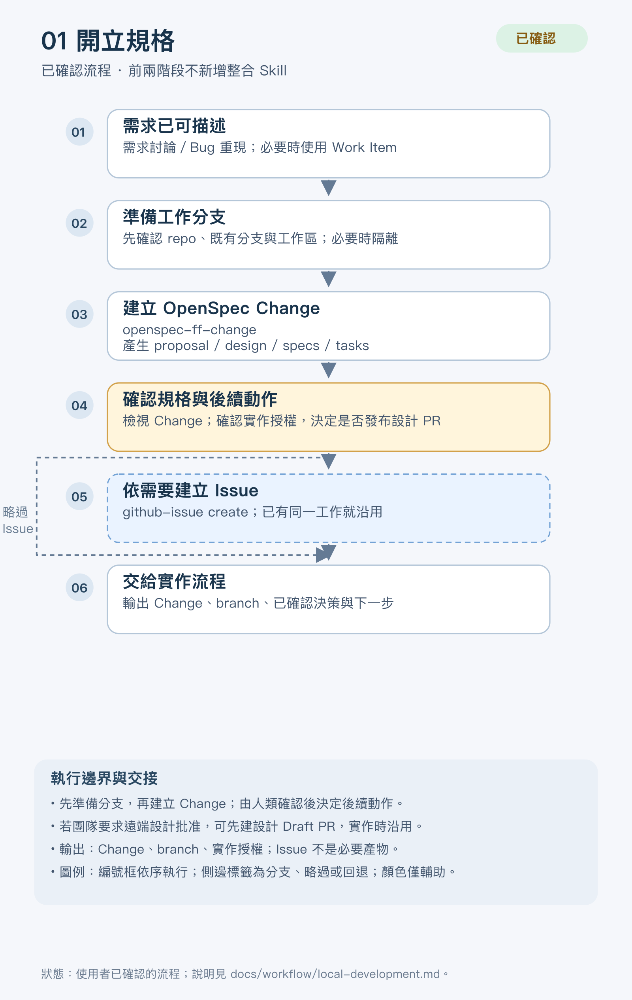
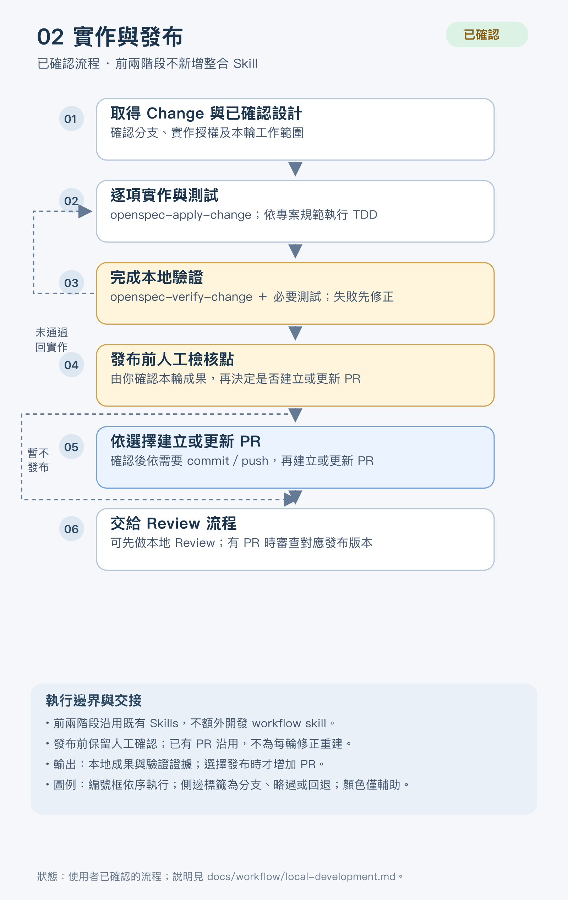
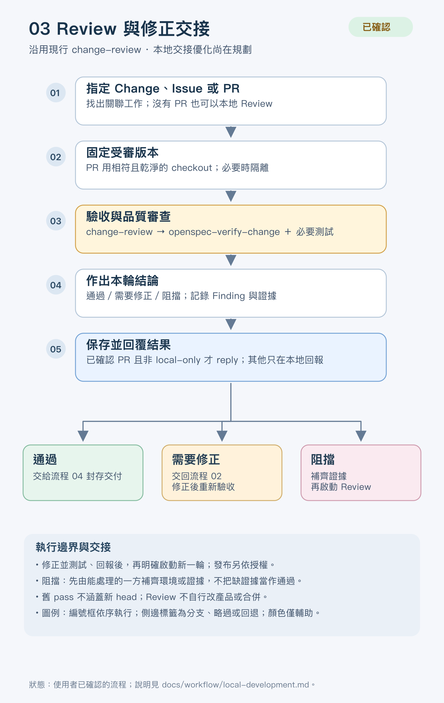
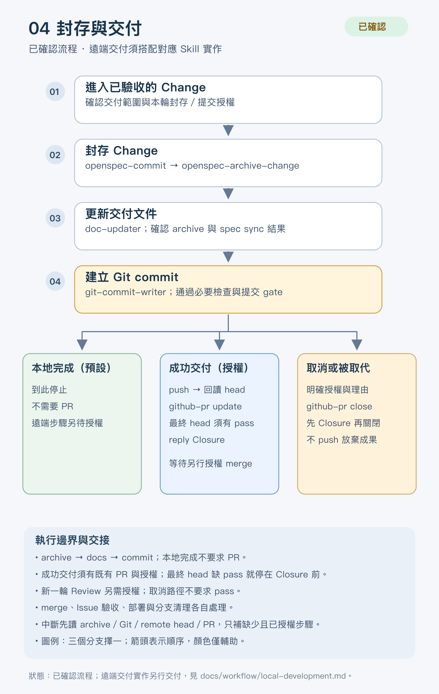

# 本機開發四階段流程

這是本 repo 自己採用的個人開發流程。使用者於 2026-11-14 確認了流程順序。它只是 wk-agent-ops 的工作方式，
installer 不會把它部署到其他專案，也不是每個安裝目標都必須採用的規範。GitHub
Issue／PR 的格式、寫入前核對與結案規則一律以 [GitHub 交接契約](../github-handoff.md)
為準，本文不另定欄位。

流程確認與能力實作是兩件事，下表分開列出：

| 階段 | 流程狀態 | 能力狀態 |
| --- | --- | --- |
| 01 開立規格 | 已確認 | 沿用既有 Skills，不新增整合 Skill |
| 02 實作與發布 | 已確認 | 沿用既有 Skills，不新增整合 Skill；發布前保留人工發布檢核 |
| 03 Review 與修正交接 | 已確認 | 沿用現有 `change-review`；本地報告、明確本機交接與延後 PR 發布的版本核對已實作並完成本地驗證 |
| 04 封存與交付 | 已確認 | 遠端交付與 commit 後恢復已在本版本 Skill 實作並完成本地驗證；真實遠端發布仍待端到端驗收 |

Review 的本地交接已由本版本 Skill 實作，並完成本地測試、installer 與離線重播驗證；真實 Session
訊息與 GitHub 寫入尚未執行。第 04 階段的遠端部分也已由本版本 Skill 實作，並完成本地 bare remote、
installer、離線重播與 Change delta strict validate；真實 Git 發布、PR update 與最終 published-head Review
的完整路徑仍待端到端驗收。[^review-skill][^delivery-design]

每張圖都有 SVG 原稿與 1600 px 寬的手機 PNG 預覽。

## 01 開立規格

[SVG 原稿](../diagrams/local-development-define.svg)

| 項目 | 內容 |
| --- | --- |
| 前提 | 需求或 Bug 已經可以描述；需要多輪討論時，可在本機使用 Work Item |
| 主路徑 | 確認 repo、既有分支與工作區 → 準備工作分支 → `openspec-ff-change` → 人工確認規格與後續動作 |
| 選用 | 需要追蹤時以 `github-issue create` 建立 Issue（已有同一工作就沿用）；團隊要求遠端設計批准時，先發布設計 Draft PR，實作時沿用 |
| 交接產物 | Change、branch、已確認範圍與實作授權；Issue 不是必要產物 |

## 02 實作與發布

[SVG 原稿](../diagrams/local-development-implement.svg)

| 項目 | 內容 |
| --- | --- |
| 前提 | Change 與已確認的設計、分支、實作授權 |
| 主路徑 | `openspec-apply-change` 逐項實作並依專案規範 TDD → `openspec-verify-change` 與必要測試 → **人工發布檢核** |
| 分支 | 驗證失敗回到實作；人工檢核決定「暫不發布」時，成果留在本機，也可以直接進本地 Review |
| 發布 | 選擇發布時才處理必要的 commit 與 push，再以 `github-pr create` 建 Draft PR，或沿用同一工作的既有 PR（另行 push 後 `github-pr update`） |
| 交接產物 | 本地成果與驗證證據；選擇發布時另有 PR 與已發布版本 |

## 03 Review 與修正交接

[SVG 原稿](../diagrams/local-development-review.svg)

| 項目 | 內容 |
| --- | --- |
| 入口 | `change-review` 指定 Change、Issue 或 PR；沒有 PR 也能做本地 Review |
| 主路徑 | 固定受審版本 → `openspec-verify-change`、適用的品質審查與必要測試 → 作出結論 → 保存報告 |
| 回報 | 已確認 PR 時，以 `github-pr reply` 發布任何結論（含 pass）並回讀；沒有 PR、查找不明或 local-only 時，依 Work Item 規範保存含快照與內容指紋的本地報告 |
| 結論 | pass 進入 04；changes-required 交回 02，實作者修正並回覆後，再明確啟動新一輪；blocked 先補齊證據。無 PR 預設不通知，使用者明確要求且原實作者身分與 Session 可核對時才本機交接 |
| 邊界 | 舊 pass 不涵蓋新 head；後補 PR 前須核對其 head 與本地快照，差異未驗證不得當成當前 PR 的 pass；Review 不修改產品，也不 merge |

## 04 封存與交付

[SVG 原稿](../diagrams/local-development-finish.svg)

由 [`openspec-commit`](commit.md) 執行。

**本地完成（預設）**：`openspec-archive-change` → `doc-updater` → `git-commit-writer`。只要求本地完成時，即使有 PR，也不會 push、建立 PR、merge 或 close。沒有 PR 也不影響本地 commit。[^commit-skill]

**成功交付（需授權）**，依序執行：

1. 正常 push，並讀回 remote head。
2. 以 `github-pr update` 說明這個版本。
3. 確認最終 head 有 Review 證據。封存與文件 commit 會產生新 head，舊 pass 不涵蓋它。
4. 以 `github-pr reply` 發布 Closure，內容寫明 ready for an authorized merge。

若最終 head 已有相符的 pass，可沿用該份證據；需要新一輪 Review 時，須有該輪審查／驗收授權。
缺少授權或結果為 changes-required／blocked 時，停在 Closure 之前。merge 另依授權處理，本流程不執行。[^delivery-design]

**取消或被取代（需明確授權與理由）**：委派 `github-pr close`。它會先發布並回讀 Closure，再關閉該 PR。放棄的成果不 push，關聯的 Issue、依賴與分支都維持原狀。

**Issue**：依原範圍驗收後，以 `github-issue close` 另行結案，不跟著 PR 一起關閉。

依交接契約，PR 正文使用 `Refs #N` 表示關聯，不使用 `Closes`／`Fixes`，以保留 Issue 的獨立結案流程。[^github-contract]

**中斷接續**：依 archive 路徑、Git history、remote head 與 PR 留言判斷已完成的部分，只補缺少且已授權的步驟，不重複 commit，也不重貼已確認的摘要。細節見 [OpenSpec Commit Workflow](commit.md)。

## 不在本流程內

- 前兩階段不新增 workflow skill。
- 本流程不包含自動 merge、連帶關閉 Issue、刪除分支、Projects、排程或自動派工。
- 遠端寫入都依當次授權執行；本文描述流程本身，不授權任何寫入。

## 來源與驗收範圍

- Review 的現行規則見 `change-review`；本地報告、明確交接與後補 PR 的版本核對以該 Skill 及對應 archive 為準。
- Commit 交付擴充的完成 tasks 與驗證範圍見 [archive tasks](../../openspec/changes/archive/2026-11-14-extend-openspec-commit-delivery/tasks.md) 及 [r02 驗證紀錄](../verification/openspec-commit/2026-11-14-extend-delivery-r02.md)。
- 圖稿索引與維護位置見 [正式圖稿索引](../diagrams/README.md)。

[^review-skill]: [Change Review 來源](../../template/common/skills/change-review/SKILL.md)。
[^commit-skill]: [OpenSpec Commit 來源](../../template/common/skills/openspec-commit/SKILL.md)。
[^github-contract]: [GitHub 交接契約](../github-handoff.md)，§5–6、§10。
[^delivery-design]: [Commit 交付擴充設計](../../openspec/changes/archive/2026-11-14-extend-openspec-commit-delivery/design.md)；實作與本地驗證狀態以對應 archive 與驗證紀錄為準。
