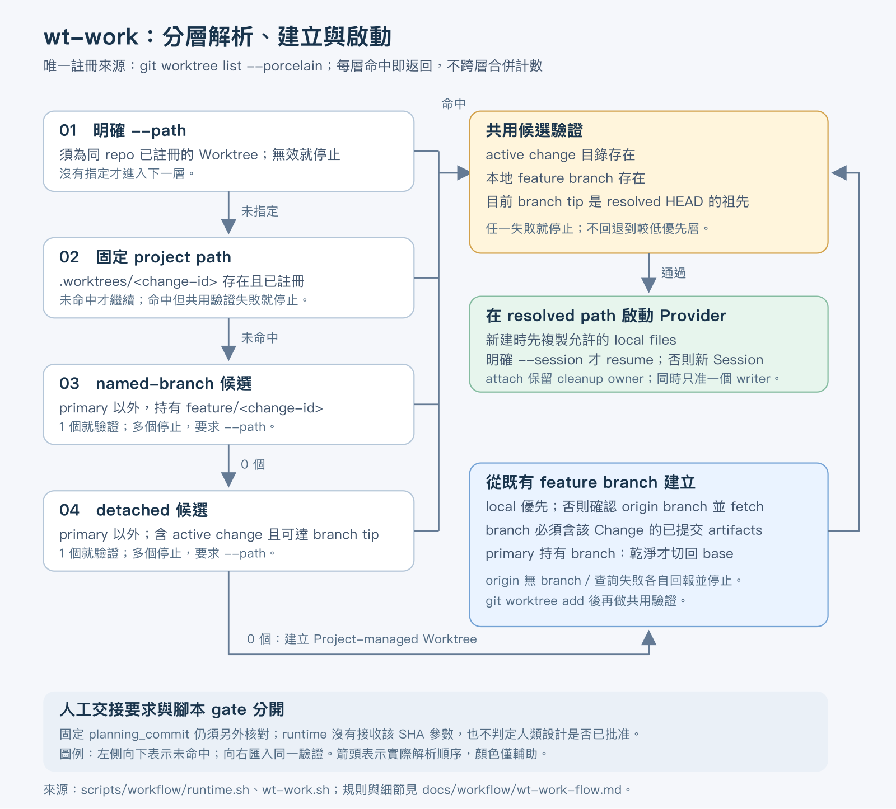

# wt-work Worktree and Branch Resolution Flow

`wt-work <change-id>` 是 **PM 規劃完成後**的可選 RD hand-off。它負責解析
既有 Worktree 或 `feature/<change-id>`，只在沒有可用 Worktree 時建立
`.worktrees/<change-id>`，再由 Provider adapter 啟動 RD Session；它不負責
釐清需求或建立 OpenSpec change。

## 標準前置條件

- OpenSpec change 已達 apply-ready，並經人類 review。
- 規劃 artifacts 已 commit 到 `feature/<change-id>`，且精確 `planning_commit`
  已知。
- 若 Worktree 已存在，取得 Git registry 中的精確 path 與 branch／detached 狀態。
- 原 active writer 與其 subagents 已停止。
- Cleanup owner 已知；attach 不會隱式轉移 ownership。

## Target Worktree Resolution

[SVG 原稿](../diagrams/wt-work-resolution.svg)



`git worktree list --porcelain` 是註冊資訊的唯一來源。解析依序執行，每層命中就驗證並返回，
不是把所有路徑合併後計數：[^resolution-runtime]

1. 有 `--path`：只驗證該路徑，無效就停止，不回退自動搜尋。
2. 未指定時：先找同 repo 已註冊的固定 `.worktrees/<change-id>`。
3. 固定路徑未命中：找 primary checkout 以外、持有 `feature/<change-id>` 的 named Worktree。
4. named 候選為零：找 primary 以外、含 active change 且 HEAD 可達目前 feature branch tip 的 detached Worktree。
5. named／detached 當層多於一個候選就停止並要求 `--path`；全部為零才進入下方建立流程。

共用驗證檢查 active change 目錄、本地 feature branch，以及 **目前 branch tip** 是否為
resolved HEAD 的祖先。這不是固定 `planning_commit` 參數的檢查；接手者仍須依
[交接規則](provider-worktrees.md#starting-ref-必須包含-planning-commit) 另外核對已批准的精確 SHA。
圖中的人工交接要求與腳本檢查分開標示。[^resolution-runtime]

## Branch Hand-off

上圖的建立分支只在解析回傳「無候選」時執行。local branch 優先；沒有時才查詢 origin。
兩條路都必須含該 Change 的已提交 artifacts。origin 確定沒有 branch 與連線／認證失敗
分別回報；兩者都停止。建立後重新做共用驗證，複製允許的 local files，再啟動 adapter。[^work-launcher]

## Path Details

### Path 1 — Local branch exists

**標準觸發條件：** PM 在同一台機器完成 branch-first 規劃，並將 artifacts commit
到 `feature/<change-id>`。

若 branch 仍 checkout 在 primary worktree，`wt-work` 會先將 primary checkout
切回 base branch，再執行：

```bash
git worktree add .worktrees/<change-id> feature/<change-id>
```

沒有 `-b`，因為 branch 已存在；RD 會直接繼承 PM 的規劃 commit。

### Path 2 — Remote-only branch

**觸發條件：** PM 在機器 A 推送 `feature/<change-id>`，RD 在機器 B 尚無本地
branch。

```bash
git fetch origin feature/<change-id>
git worktree add .worktrees/<change-id> \
  -b feature/<change-id> origin/feature/<change-id>
```

`git ls-remote` 的「branch confirmed absent」與 transport／authentication error
分開處理；兩者都停止，且後者會明確回報 origin query failure。

### Path 3 — No reviewed branch

若 local 與 origin 都沒有 `feature/<change-id>`，`wt-work` 會停止並要求完成
branch-first planning hand-off；不再從 base 建立空 feature branch。

## Cross-Machine Scenario

```text
Machine A (PM)                          Machine B (RD)
──────────────────────────────          ──────────────────────────────
scope ready
  └─ create feature/change-id
       └─ openspec-ff-change
            └─ human review + commit
                 └─ git push origin feature/change-id
                                      │
                                      └─ wt-work change-id
                                           └─ fetch + worktree add
                                                └─ RD apply session
```

Remote push 仍是手動步驟；`wt-done` 也仍是 local-only。

## Provider Adapter Boundary

Worktree resolution 完成後，Provider adapter 才接手：

```text
start_session(provider, cwd=<resolved-path>, apply_prompt)
resume_session(provider, cwd=<resolved-path>, session, apply_prompt)
```

Adapter 只處理 Provider 的 cwd、session 與 prompt 差異，不應重新建立 branch、
Worktree 或 OpenSpec change。切換 Provider 時停止舊 active writer，再以相同
`resolved-path` 啟動新 adapter；這是 `wt-work` 的 new-session 路徑。
`wt-resume` 只恢復同一 Provider 的 session，session history 不會跨 Provider
轉移。

Project-managed Worktree 建立後，core 複製 `.env`，Provider adapter 只複製所選
LLM Provider 已知且存在的 local settings。它不複製所有 Provider 設定，也不
自動安裝 dependencies 或建立 `.worktreeinclude`。

Provider 矩陣見
[PM/RD 多 Agent 協作工作流](/docs/workflow/guide.md#目標-provider-矩陣)。

## 相關文件

- [PM/RD 多 Agent 協作工作流](/docs/workflow/guide.md)
- [OpenSpec、Git 與 Session 邊界](/docs/workflow/concepts.md)
- [Provider-native Worktree Reference](/docs/workflow/provider-worktrees.md)
- [Workflow 腳本手冊](/scripts/workflow/README.md)
- [正式圖稿索引](../diagrams/README.md)

[^resolution-runtime]: [runtime.sh](../../scripts/workflow/runtime.sh)，`workflow_resolve_worktree`、`workflow_check_candidate`。
[^work-launcher]: [wt-work.sh](../../scripts/workflow/wt-work.sh)，resolve status、local／origin branch 與 `copy_local_file` 路徑。
